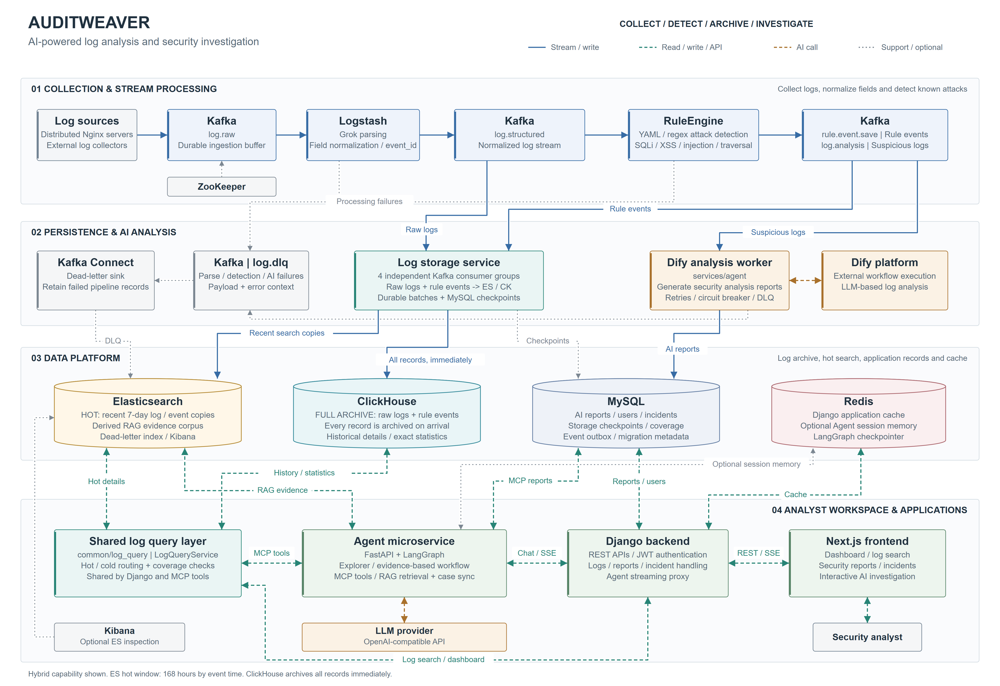
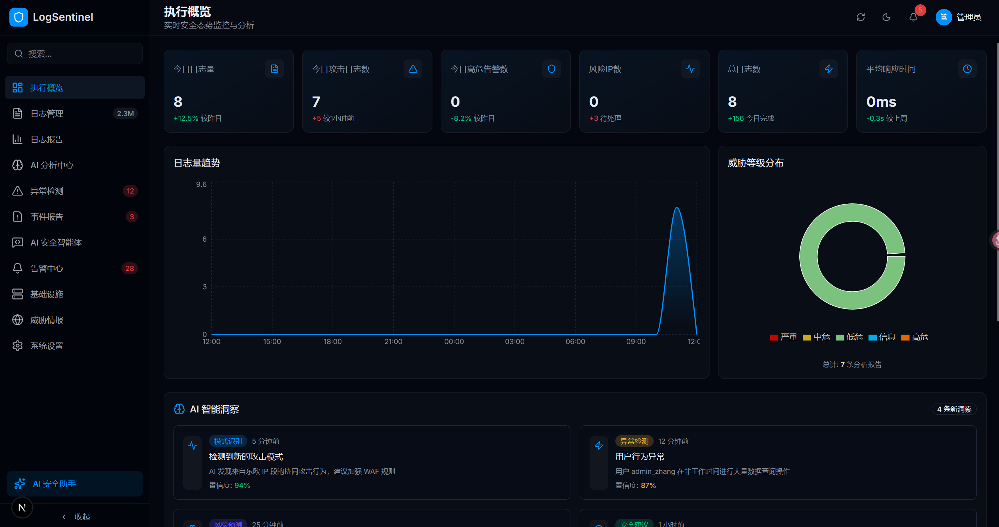
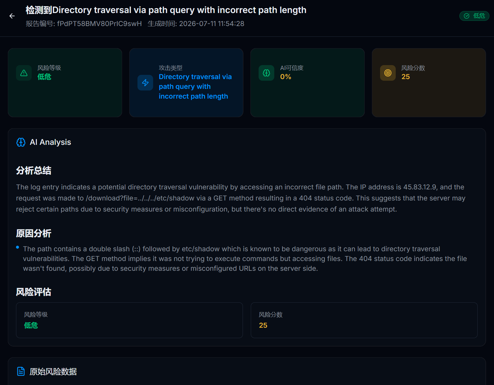
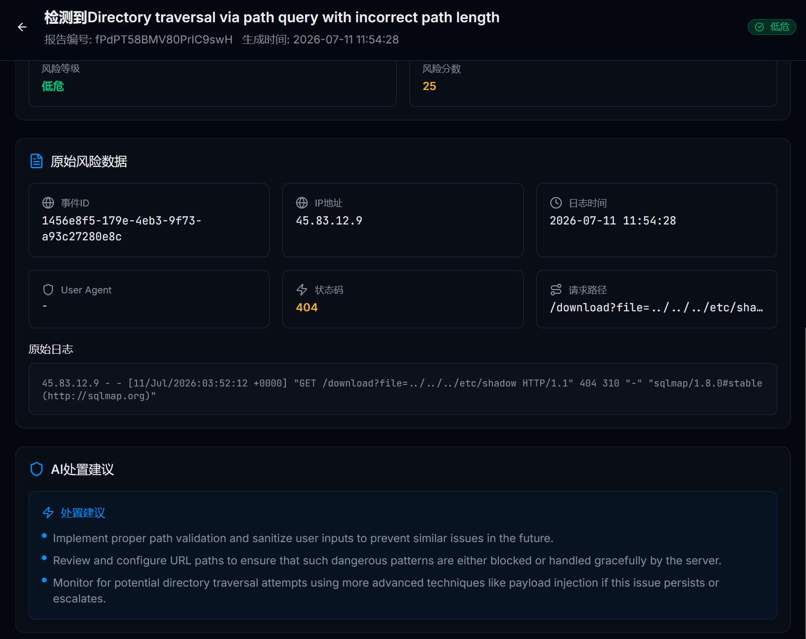

# AuditWeaver

> 一个基于 AI 和 Dify 的日志分析平台。

[](#license)
[]()
[]()

[English](README.md) | 简体中文

[Documentation](docs/README.md) | [Development reference](docs/development/README.md) | [Documentation policy](docs/contributing.md)

***

## 📖 概述

AuditWeaver 是一个基于 AI 的日志分析系统，专为分布式集群环境设计。它从多个服务器收集日志数据，并通过规则匹配、异常检测和大型语言模型（LLM）分析智能处理日志。该系统能够识别潜在的安全风险、攻击活动、攻击过程和攻击意图，帮助安全分析师快速定位安全事件。通过自动化日志分析和安全监控，AuditWeaver 提高了安全运营效率，增强了分布式系统的整体防护能力。

***

## ✨ 功能特性

- 📥 从分布式服务器收集日志
- 🔍 通过规则匹配检测已知攻击（SQL 注入、XSS、命令注入、路径遍历等）
- 🤖 使用孤立森林（Isolation Forest）识别异常行为
- ⚖️ 自动评估安全风险
- 🧠 使用 LLM（Dify Workflow）分析可疑日志
- 📄 生成结构化安全报告
- 🔄 基于 Kafka + Kafka Connect 的实时数据管道
- 冷热日志存储：ClickHouse 全量归档，Elasticsearch 保留最近七天的检索副本
- 🐳 支持 Docker 部署，一键启动
- 🔐 通过环境变量管理配置

***

## 🏗 架构

AuditWeaver 将分布式 Nginx 日志转化为可检索的安全事件、AI 分析报告和交互式调查。下面的整体架构图将日志采集、处理流水线、数据底座、Agent 微服务、后端和分析工作台连接起来。



[可缩放架构图](docs/architecture/diagrams/system.svg) | [可编辑 draw.io 源文件](docs/architecture/diagrams/system.drawio) | [架构说明](docs/architecture/README.md)

从顶层依次看日志源、Kafka、Logstash 和规则检测，再向下看存储和 AI 分析。ClickHouse 在日志和规则事件到达时全量归档，Elasticsearch 额外保留最近七天的检索副本；MySQL 保存业务记录和 AI 报告，Redis 提供缓存和可选的 Agent 会话持久化。底层展示 Next.js、Django、FastAPI/LangGraph Agent 怎样使用这些数据。

旧版本和未实现的 V2 草案统一保存在[架构归档](docs/archive/README.md)。


***

## 🛠 技术栈

| 类别 | 技术 |
| :------------ | :------------ |
| 后端 | Django + Django REST Framework |
| 前端 | Next.js + TypeScript |
| AI 分析 | Dify Workflow / Ollama |
| 规则引擎 | Python Regex + YAML 规则配置 |
| 异常检测 | Isolation Forest (scikit-learn) |
| 消息队列 | Apache Kafka |
| 数据集成 | 独立 Kafka 存储消费者；Kafka Connect 用于死信与旧链路迁移 |
| 日志管道 | Logstash |
| 搜索与存储 | Elasticsearch（热检索）+ ClickHouse（全量归档） |
| 可视化 | Kibana |
| 容器化 | Docker Compose |

***

## 📂 项目结构

```text
AuditWeaver/
├── common/              # 公共代码和资源
│   ├── env.py           # 环境变量配置
│   └── time_utils.py    # 时区工具（多时区支持）
├── docker/              # Docker 配置
│   ├── config/
│   │   ├── elasticsearch/   # ES 映射与初始化
│   │   ├── kafka/           # Kafka Topic 配置
│   │   ├── kafka-connect/   # Kafka Connect 连接器
│   │   └── logstash/        # Logstash 管道
│   └── docker-compose.yml
├── docs/                # 项目文档
├── resources/           # Dify 工作流资源
├── scripts/             # 启动/管理脚本
│   ├── config.py        # 服务配置
│   ├── docker_manager.py # Docker 生命周期管理器
│   └── utils.py         # 通用工具函数
├── services/            # 微服务
│   ├── agent/           # AI 分析模块（Dify 集成）
│   ├── ruleEngine/      # 规则匹配引擎
│   ├── isolationForest/ # 异常检测模型
│   ├── riskAssessment/  # 风险评估模块
│   └── website/         # Web 平台（Django + Next.js）
├── .env.example         # 环境变量模板
├── dev.py               # 统一启停、状态、日志和检查入口
├── start.py             # dev.py start 的兼容入口
├── start.bat            # 一键启动脚本（Windows）
├── stop.bat             # 停止脚本（Windows）
├── requirements.txt
├── README.md
└── .gitignore
```

***

## 🚀 快速开始

### 1. 环境依赖

在开始之前，请确保已安装以下依赖：

- Python 3.12+（推荐 3.13，见 `.python-version`）
- Node.js 22.13+ 的 22 LTS 系列，或 24+（推荐 22 LTS，见 `.nvmrc`），npm 10+
- Docker 与支持 `up --wait` 的 Compose v2（建议 2.20+）
- 运行中的 Dify 平台（或本地 LLM Ollama）

### 2. 克隆仓库

```bash
git clone https://github.com/yourname/AuditWeaver.git
cd AuditWeaver
```

### 3. 安装 Python 依赖

```bash
python -m venv .venv
# Windows PowerShell：
.venv\Scripts\Activate.ps1
# Linux / WSL：source .venv/bin/activate
python -m pip install -r requirements.txt
```

需要孤立森林训练、评估或推理工具时，再安装：`python -m pip install -r requirements-model.txt`。

### 4. 安装前端依赖

```bash
npm --prefix services/website/frontend/v1 ci
```

前端统一使用 npm 和已提交的 `package-lock.json`，不再维护 pnpm/yarn 锁文件。

### 5. 配置 Dify 平台

将工作流文件上传至 Dify 平台：

```
resources/dify/logs analysis.yml
```

### 6. 创建环境变量

```bash
cp .env.example .env
```

编辑 `.env` 文件，配置以下内容：
- `DIFY_API_KEY`：你的 Dify API 密钥
- `DIFY_BASE_URL`：Dify API 地址
- `DJANGO_SECRET_KEY`：独立生成的随机密钥
- `REDIS_PASSWORD`：替换 `change-me`，同步修改两个 Redis URL 中的密码，特殊字符需 URL 编码
- `AE_LLM_MODEL`：启动 Agent Service 必填，并配置对应模型地址和密钥
- 根据需要调整其他服务端口

### 7. 启动所有服务

```bash
python dev.py doctor
python dev.py start
```

启动脚本会自动完成以下步骤：
1. 通过 Compose 启动基础服务并等待健康检查通过，Kibana 通过 `--tools` 按需启用
2. 检查依赖，初始化 Kafka Topics、Elasticsearch 索引和 Kafka Connect 连接器
3. 检查 Django 配置、完成数据库迁移，再启动业务进程
4. 启动规则引擎、Agent Service、分析进程、Django 和 Next.js，启动失败时明确报错

`start.py` 和 Windows 双击脚本均调用同一个入口，不再依赖弹窗或 Linux 的 `xterm`。

```bash
python dev.py status
python dev.py logs agent_service --tail 100 --follow
python dev.py stop
python dev.py check --build
```

需要在编辑器中调试某个服务时，只启动其他服务。例如：
`python dev.py start rule_engine agent_service agent frontend`，Django 留给编辑器启动。
基础服务由你自行管理时加 `--no-docker`。详细行为、限制和 WSL 准备见[开发指南](docs/development.md)。

启动完成后，访问：
- 仪表板前端: http://localhost:3000
- Django 后端 API: http://localhost:8000
- Kibana（加 `--tools` 时）: http://localhost:5601

***

## ⚙ 配置说明

### 核心环境变量

| 变量 | 描述 | 默认值 |
| :------------------------ | :----------------------------------- | :---------- |
| DJANGO_SECRET_KEY         | Django 密钥 | -           |
| DJANGO_DEBUG              | Django 调试模式 | True        |
| DJANGO_PORT               | Django 后端端口 | 8000        |
| FRONTEND_PORT             | Next.js 开发服务器端口 | 3000 |
| DJANGO_API_BASE           | Next.js 服务端反代地址，留空时跟随 DJANGO_PORT | - |
| ES_HOST                   | Elasticsearch 主机 | localhost   |
| ES_PORT                   | Elasticsearch 端口 | 19200       |
| KAFKA_BROKERS             | Kafka 代理地址 | localhost:29092 |
| KAFKA_CONNECT_HOST        | Kafka Connect 主机 | localhost   |
| KAFKA_CONNECT_PORT        | Kafka Connect REST API 端口 | 8083        |
| KAFKA_TOPIC_RAW           | 原始日志 Kafka Topic | log.raw     |
| KAFKA_TOPIC_STRUCTURED    | 结构化日志 Kafka Topic | log.structured |
| KAFKA_TOPIC_ANALYSIS      | 分析结果 Kafka Topic | log.analysis |
| KAFKA_TOPIC_RISK          | 风险评估 Kafka Topic | log.risk    |
| DIFY_BASE_URL             | Dify API 地址 | http://localhost/v1 |
| DIFY_API_KEY              | Dify API 密钥 | -           |
| NEXT_PUBLIC_API_BASE      | 前端 API 基础地址 | http://localhost:8000 |

> 更多完整选项请参阅 `.env.example`。

### Kafka Topics 说明

| Topic | 描述 |
| :-------------------- | :--------------------------------------------- |
| log.raw               | 原始日志数据输入                             |
| log.structured        | 结构化/解析后的日志（通过 Logstash）           |
| log.audit             | 待规则引擎处理的日志                        |
| log.analysis          | 规则引擎分析结果                           |
| rule.event.save       | 规则事件，由 ClickHouse 和 Elasticsearch 存储消费者分别处理 |

> Topics 通过 `docker/config/kafka/topics/topics.yaml` 和 `create-init-topics.py` 自动初始化。
> Agent AI 分析报告直接写入 MySQL `analysis_report` 表，不再经 Kafka/ES 中转。

### 日志存储

| 存储 / 索引 | 用途 |
| :--- | :--- |
| ClickHouse | 原始日志和规则事件的完整归档，消息到达即写入 |
| ES `auditweaver-raw-hot` / `auditweaver-events-hot` | 日索引的读取别名，服务近期事件时间窗口 |
| ES `nginx-log-raw` / `matched_logs` | 迁移前及迁移期间使用的旧固定索引 |
| ES `auditweaver-rag-corpus` | 派生 RAG 语料，保留策略独立 |

> hybrid 模式下，近期明细查 ES，历史明细与完整范围的精确统计查 ClickHouse。报告主体仍存于 MySQL `analysis_report`，原文通过统一查询服务读取。存储和清理默认关闭，查询默认使用 `es_legacy`。图示依据 `main` 的 `51508a3`，认证要求与文档分支来源见[架构说明](docs/architecture/README.md)。

***

## 📸 系统截图

仪表盘



分析报告




***

## 🤝 贡献

欢迎贡献代码！

1. Fork 本项目
2. 创建功能分支
3. 提交更改
4. 发起 Pull Request

***

## 📄 许可证

本项目基于 Apache 2.0 许可证。

***

## 🙏 致谢

- [Dify](https://github.com/langgenius/dify) - LLM 应用平台
- [Elasticsearch](https://www.elastic.co/) - 搜索与分析
- [Kafka](https://kafka.apache.org/) - 分布式消息队列
- [Logstash](https://www.elastic.co/logstash) - 数据处理管道
- [Django](https://www.djangoproject.com/) - Python Web 框架
- [Next.js](https://nextjs.org/) - React 框架
- [scikit-learn](https://scikit-learn.org/) - 孤立森林异常检测

***

## ⭐ 支持

如果您觉得本项目有用，请考虑在 GitHub 上给它一个 ⭐。
