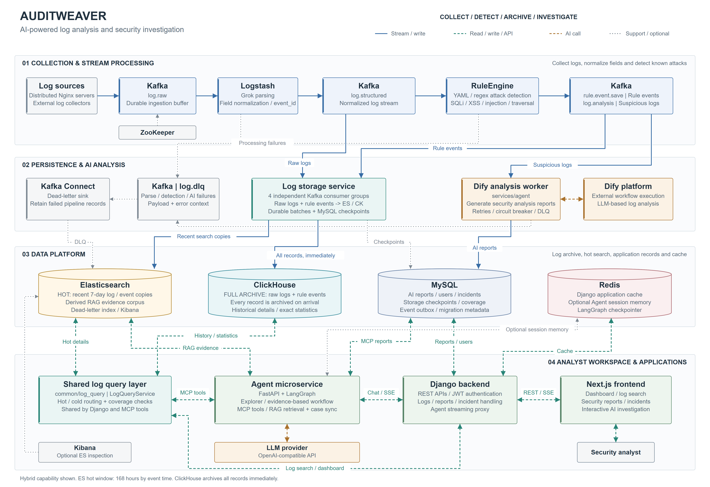

# Architecture

AuditWeaver turns distributed Nginx logs into searchable security events, AI analysis reports, and interactive investigations. This overview connects the complete path from external log collection to the analyst's workspace.

The diagram shows the implemented **hybrid query mode**, reviewed against `main` at `51508a3`, with the presentation updated on November 13, 2026. Hybrid reads require migration and coverage certification; deployment defaults are described below.

## Complete System Architecture

[Scalable SVG](diagrams/system.svg) | [Editable draw.io source](diagrams/system.drawio)

Read the top row from left to right, then follow the write paths downward into the data platform. The bottom row starts at the analyst on the right and connects the frontend, backend, Agent, and shared log reader.

1. **Collection and stream processing:** external collectors send Nginx logs to Kafka `log.raw`. Logstash parses and normalizes them into `log.structured`. RuleEngine detects known attacks and produces rule events (`rule.event.save`) and suspicious logs (`log.analysis`).
2. **Persistence and AI analysis:** independent storage workers consume structured logs and rule events. Separately, the Dify worker consumes suspicious logs, calls Dify workflows, and saves AI reports in MySQL. Failed pipeline messages flow through `log.dlq` and Kafka Connect into the ES dead-letter index.
3. **Data platform:** Elasticsearch serves recent log/event search and the derived RAG corpus. ClickHouse archives every log/event on arrival and supports historical queries and exact statistics. MySQL owns application records, reports, and storage metadata. Redis provides application caching and optional Agent checkpoints.
4. **Analyst applications:** Next.js calls Django for dashboards, log search, reports, incidents, and investigation chat. Django proxies streaming Agent requests to FastAPI/LangGraph. The Agent uses an external LLM, MCP tools, and RAG evidence. Django and MCP log/event tools use the same query layer.

Blue solid arrows carry streams and writes. Green dashed arrows show data access and application calls. Amber dashed arrows show external AI calls. Gray dotted arrows show supporting or optional paths. Bidirectional arrows include requests and responses; they do not imply that each caller writes to the destination.

The Kafka boxes identify stages/topics in the configured Kafka service, not separate clusters. Likewise, the four data stores appear once each even when several services use them. Functional bands do not imply separate deployments or high availability.

The Dify analysis worker (`services/agent`) runs background analysis. The interactive Agent microservice (`services/agent_service`) runs user-directed investigations. Their separate positions in the diagram reflect these different workloads.

## Focused References

The complete system diagram is the project introduction. Use the following views for implementation details:

- [Storage internals](diagrams/log-storage.png): independent workers, metadata, failed inputs, migration, and cleanup.
- [Agent internals](diagrams/agent-detail.png): graph routing, tools, RAG synchronization, and memory.
- [Agent workflow references](../development/agent-service/README.md): individual graph sources and component ownership.
- [Logical Mermaid source](diagrams/system-architecture.mmd): a text-based companion to the overall architecture.
- [Component inventory](diagrams/system-simple.png): an optional six-area reference, with its own numbering.

The overview shows primary component relationships. Coverage certification, quarantine, backfill, cleanup, and individual graph steps are expanded in the focused references. The repository also contains Isolation Forest and risk-assessment modules; they are not shown as active stages because the reviewed stream pipeline does not wire them into its processing path.

## Storage Behavior

ClickHouse receives **all raw logs and rule events from ingestion onward**. Elasticsearch holds a searchable hot copy for the latest **168 hours by event time** by default (`LOG_HOT_RETENTION_DAYS=7`). A late event outside that window is still archived in ClickHouse and does not recreate an expired hot index.

Four independent Kafka consumer groups run under the storage supervisor: ClickHouse/raw, ClickHouse/events, Elasticsearch/raw, and Elasticsearch/events. Each worker persists its sink batch, persists MySQL metadata, then commits Kafka offsets. Replay is version-aware; this is not a distributed transaction across the sinks. Invalid input is quarantined, recorded as a gap, and stops consumption without committing the failed offset.

The shared `common/log_query/LogQueryService` serves web logs, dashboard statistics, report original-log lookups, and MCP log/event tools. In hybrid mode:

- Detail queries split at a fixed event-time boundary: recent records from ES, older records from ClickHouse. Signed cursors pin the boundary and time range.
- Exact aggregates query ClickHouse over the **entire requested range**, including recent records.
- Missing certification, unresolved gaps, or excessive checkpoint lag make the query unavailable rather than silently returning an incomplete result.

AI report bodies, users, and incidents remain in MySQL. Redis remains the cache and optional Agent checkpointer. The derived RAG corpus remains in ES: case synchronization bootstraps through the shared reader, then consumes the MySQL event outbox and reads the latest archived events from ClickHouse.

## Migration and Retention

| Query Mode | Recent Details | Older Details | Purpose |
| --- | --- | --- | --- |
| `es_legacy` | Legacy ES indexes | Legacy ES indexes | Default; retain the original read path during shadow writes |
| `transition` | New ES hot aliases | Legacy ES indexes | After hot coverage certification, while history is backfilled |
| `hybrid` | New ES hot aliases | ClickHouse | After archive coverage certification |

The old raw-log and event Kafka Connect sinks remain during shadow writes. Handoff is explicit: stop those connectors and disable their recreation. The `log.dlq` Kafka Connect sink remains active. Backfill reads sealed legacy `nginx-log-raw` / `matched_logs` indexes into ClickHouse, with an optional recent ES copy.

The defaults remain `STORAGE_ENABLED=false`, `LOG_QUERY_MODE=es_legacy`, `ES_CLEANUP_ENABLED=false`, and `ES_CLEANUP_DRY_RUN=true`. A seven-day hot query window does not itself delete old indexes. Guarded cleanup requires verified archive content, versions, coverage, checkpoints, and backup/restore evidence; it only deletes eligible hot daily indexes. Legacy fixed indexes are excluded. ClickHouse currently has no automatic TTL.

Implementation references at the reviewed commit are `services/log_storage/README.md`, `services/log_storage/worker.py`, `services/log_storage/hot.py`, `services/log_storage/archive.py`, `common/log_query/service.py`, and `services/agent_service/shared/rag/case_sync.py`. The documentation branch is based on an older `develop`; this update does not import the newer runtime code from `main`.

## Editing and History

The full system presentation uses an editable draw.io source to keep the connected layout stable. Its SVG and PNG are presentation exports. The focused views and optional inventory use Mermaid with the shared [render configuration](diagrams/mermaid.config.json).

| View | Editable Source | PNG | Scalable SVG |
| --- | --- | --- | --- |
| Complete system architecture | [draw.io](diagrams/system.drawio) | [Image](diagrams/system.png) | [SVG](diagrams/system.svg) |
| Storage internals | [Mermaid](diagrams/log-storage.mmd) | [Image](diagrams/log-storage.png) | [SVG](diagrams/log-storage.svg) |
| Agent internals | [Mermaid](diagrams/agent-architecture-detail.mmd) | [Image](diagrams/agent-detail.png) | [SVG](diagrams/agent-detail.svg) |
| Optional component inventory | [Mermaid](diagrams/system-architecture-simple.mmd) | [Image](diagrams/system-simple.png) | [SVG](diagrams/system-simple.svg) |

Update the relevant editable source and both exports together. The logical Mermaid companion captures relationships rather than the presentation layout; it does not generate `system.png` or `system.svg`. See the [editing and export instructions](diagrams/README.md).

Earlier [platform drawings and exports](../archive/architecture/pre-hot-cold/) are historical. They predate the storage change and are excluded from the current architecture views. [Agent workflow diagrams](../development/agent-service/README.md) provide component-level references; the [architecture archive](../archive/README.md) retains previous versions and the unimplemented V2 proposal.
